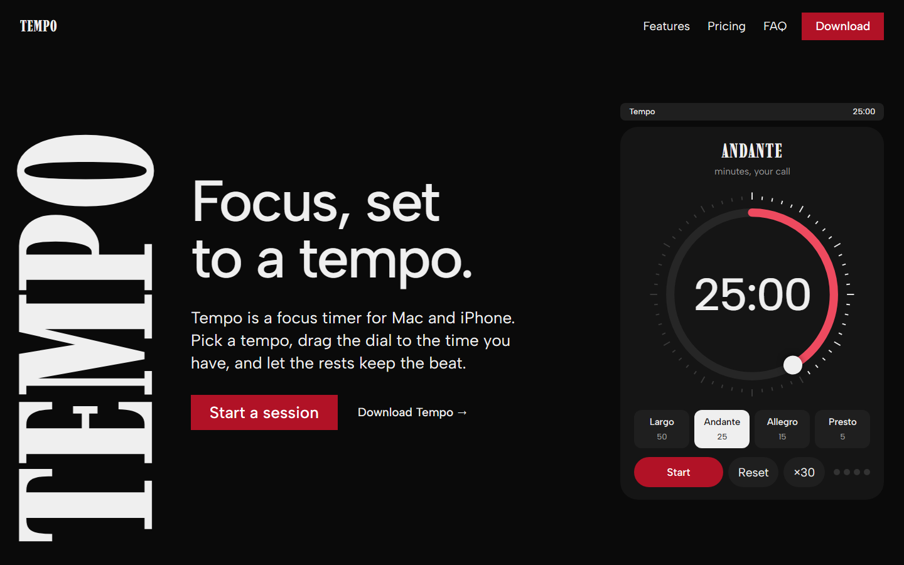

# Tempo

**A focus timer for Mac and iPhone where session lengths are named like musical tempos.** This repo is the landing page, with a real, playable version of the timer in the hero.



> Portfolio project. **Tempo is a fictional brand**: the product, prices and copy are made up, and no real company, logo or site is imitated.

## What to try

- **Drag the dial.** It tracks your finger 1:1 from wherever you grab it. Let go with a flick and it *projects* where the momentum would carry it, springs there with your release velocity, and lands on the nearest five minutes. Past 5 or 60 minutes it rubber-bands.
- **Grab it mid-flight.** Every animation can be caught and reversed; the spring restarts from the value on screen.
- **Start a session**, then switch on **×30** to watch a full focus, rest and beat cycle in about 20 seconds. The menu-bar strip and the tab title count down with it.
- **Keyboard:** Tab to the dial, then arrow keys, Page Up/Down, Home and End.

## Stack

React 19, TypeScript, Vite. [`motion`](https://motion.dev) for springs only (no UI framework, no CSS library). Fonts (Imbue, Albert Sans) are self-hosted through Fontsource, so the page makes no third-party requests.

## Design and motion

- **Idea:** the name *Tempo* is a musical term, so session lengths are named the way a score names speed: Largo 50, Andante 25, Allegro 15, Presto 5. The name itself is the monument, set vertically up the left edge of the first screen.
- Direction dealt by [tasteskill](https://github.com/) (*The name as a monument*, black and crimson, Imbue / Albert Sans), checked in a real browser with its inspector at 1440, 768 and 390 px: 0 failures. One redraw: the stock hero (name split to corners) cannot hold a live demo, so the name stands vertically beside it.
- **Apple-style motion** (from the *Designing Fluid Interfaces* talk): response on pointer-down, 1:1 direct manipulation, momentum projection (`v · 0.998 / (1 − 0.998)`), velocity hand-off into a critically damped spring, bounce only when a flick carried momentum, rubber-banding at the ends, interruptible everything.
- The countdown runs on timestamps, not ticks, so it stays correct after a background tab or a slow frame.
- Press feedback on every control, a pinned story that swaps the dial state as you scroll, scroll-linked drift on the pictures, staggered entrances that never hide content if scripts fail.
- `prefers-reduced-motion`: springs become jumps, entrances become fades, the video loop stops on its poster frame. Contrast, focus rings and `prefers-contrast` are handled.

Measured with Lighthouse on the production build (desktop): Performance 97, Accessibility 100, Best Practices 100, SEO 100 after adding `robots.txt`.

## Run it

```bash
npm install
npm run dev        # http://localhost:5173
npm test           # dial math: projection, rubber-band, snapping (Node 22+)
npm run build      # type-check + production build into dist/
npm run preview
```

## Deploy

`vite.config.ts` sets `base: './'`, so every path is relative. Push to `main` and `.github/workflows/pages.yml` builds and publishes with the official `actions/deploy-pages`. In the repo settings, set **Pages → Source** to **GitHub Actions**.

## Credits

All media are openly licensed and were found with the tasteskill asset search.

| Media | Author | Licence | Source |
| --- | --- | --- | --- |
| "Metronome" (video and poster, `public/img/metronome.webm`) | Daniel Eriksson | CC BY 4.0 | [Wikimedia Commons](https://commons.wikimedia.org/wiki/File:Metronome.webm) |
| "Music manuscript" (cropped, `public/img/manuscript.jpg`) | Smithsonian National Museum of American History | CC0 | [n2t.net/ark:/65665/ng49ca746aa-a940-704b-e053-15f76fa0b4fa](https://n2t.net/ark:/65665/ng49ca746aa-a940-704b-e053-15f76fa0b4fa) |

Fonts: [Imbue](https://fonts.google.com/specimen/Imbue) and [Albert Sans](https://fonts.google.com/specimen/Albert+Sans), SIL Open Font Licence.

Designed and built by [Eduardo Nitz](https://github.com/DadoNitz). *Projeto de portfólio, marca fictícia.*
